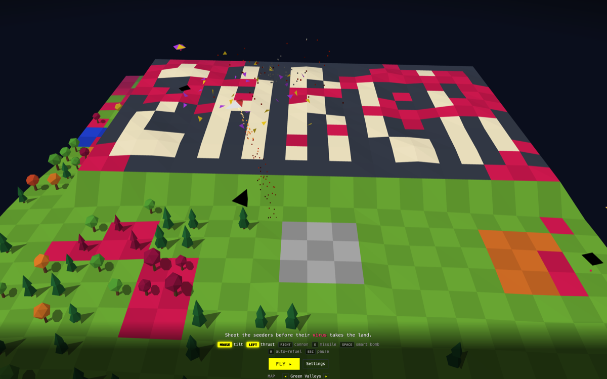

# Zarch in Chrome

A browser tribute to **Zarch** (David Braben, Acorn Archimedes, 1987), later ported to the Atari ST and Amiga as **Virus**. You fly a hovercraft-style lander over a wrapping, tiled landscape. Seeders spread a red virus across the land and fighters hunt you. Stop the virus before it takes over.

**Play it:** https://brew-your-own.github.io/zarch-in-chrome/



The title screen plays the game by itself: a computer pilot defends the word ZARCH, written into the landscape, while the virus slowly eats it. The controls light up as the pilot uses them. Press **Fly** to take over, pick a map with the arrows, or open **Enemies** for a guide to what you'll be fighting.

## Controls

| Input | Action |
|---|---|
| Move the mouse | Tilt the craft (it leans towards the pointer; thrust pushes along its tilt) |
| Left button | Thrust |
| Right button | Fire |
| Middle button or E | Homing missile: locks onto the nearest enemy (one more each wave, they build up) |
| Space | Smart bomb: clears every enemy around you (one per wave from wave 3) |
| R | Auto-refuel: fly back to the pad and land (once per wave) |
| Esc | Pause: settings, resume, or quit to the title |

Land gently on the grey launch pad to refuel. The pad is also a safe haven: fighters hold fire while you sit on it.

The enemies:

- **Seeders** wander the map dropping spores that infect the land.
- **Mutants:** a seeder left alive for 40 seconds mutates. It keeps spreading the virus, and it hunts you too, diving at you from above. Keep moving and it misses.
- **Fighters** join from wave 2. They circle you and shoot.
- **Bombers** join from wave 3. They fly straight across the map, laying the virus in long lines, and take three hits to bring down.

Each map has a few **villages**. When the virus reaches a building it starts to pulse red, and about 15 seconds later it falls to a ruin that keeps spreading the virus. To save it, hover low over it for two seconds: that cures it and cleans the ground around it. Every wave you survive pays a bonus for each building still standing, and if every building falls, the game is over.

Each wave is a little harder than the last: enemies move and shoot faster and aim better, up to a cap.

The settings panel, opened from the title screen or by pausing, has the map picker and lets you tune physics, enemies, difficulty, weapons, lives, colours, sound and music. Settings are saved in your browser.

## Development

Built with Vite, TypeScript and Three.js. Everything, including the sound and music, is generated in code: there are no asset files.

All the code was written by [Claude Code](https://claude.com/claude-code), guided by the prompts listed in [PROMPTS.md](PROMPTS.md). The first session built the whole game, from an empty folder to smart bombs and homing missiles, in about 4 hours 30 minutes. Claude was working for about 1 hour 20 minutes of that; the rest was the time between prompts.

```sh
npm install
npm run dev      # http://localhost:5173
npm test         # Vitest
npm run build    # type-check and build to dist/
```

Every push to `main` is tested, built and deployed to GitHub Pages by `.github/workflows/deploy.yml`.
